# TalleresMoviles

**Estudiante:** Juan Esteban Vera Castro 
**Código:** 230232042

## Pasos para ejecutar
1. `flutter pub get`
2. `flutter run` (en Android o Windows; la pantalla de Isolate no funciona en web)
3. `flutter test` para correr las pruebas

---

# Taller: Distribución con Firebase App Distribution

Rama: `feature/app_distribution` (creada desde `dev`)

## Flujo

```
Generar APK  →  App Distribution  →  Testers  →  Instalación  →  Actualización
(flutter build    (subir release      (grupo        (correo /       (1.0.0 → 1.0.1,
 apk, firmado)     + release notes)    QA_clase)     App Tester)     se redistribuye)
```

1. **Generar APK:** `flutter build apk --release` genera `build/app/outputs/flutter-apk/app-release.apk`, firmado con la clave propia del proyecto.
2. **App Distribution:** el APK se sube a Firebase como un *release* y se le adjuntan las Release Notes.
3. **Testers:** el release se asigna al grupo `QA_clase` (`dduran@uceva.edu.co` y `veraj4176@gmail.com`). Firebase les envía un correo de invitación.
4. **Instalación:** el tester acepta la invitación y descarga la app desde **Firebase App Tester** o desde el enlace del correo.
5. **Actualización:** se cambia la app, se sube la versión en `pubspec.yaml`, se compila y se redistribuye. El tester ve la nueva versión en App Tester y la instala encima de la anterior.

| Dato | Valor |
|---|---|
| Proyecto Firebase | `talleresmoviles-403ec` |
| applicationId | `co.edu.uceva.talleresmoviles` |
| ID de la app | `1:506124819781:android:6bee8c3c46d6a3044fb22c` |
| Grupo de testers | `QA_clase` (alias `qa-clase`) |
| Enlace de instalación 1.0.0 | https://appdistribution.firebase.google.com/testerapps/1:506124819781:android:6bee8c3c46d6a3044fb22c/releases/0e24tth5civk0 |
| Enlace de instalación 1.0.1 | https://appdistribution.firebase.google.com/testerapps/1:506124819781:android:6bee8c3c46d6a3044fb22c/releases/63p793uib72ko |

## Publicación

### Preparación (una sola vez)

1. **Permiso de internet** en `android/app/src/main/AndroidManifest.xml`:
   ```xml
   <uses-permission android:name="android.permission.INTERNET"/>
   ```
2. **Icono de la app** con `flutter_launcher_icons` (configurado en `pubspec.yaml`, imagen en `assets/icon/app_icon.png`):
   ```bash
   dart run flutter_launcher_icons
   ```
3. **applicationId propio** en `android/app/build.gradle.kts`: `co.edu.uceva.talleresmoviles`.
4. **Firma de release:** el build de release se firma con `upload-keystore.jks`. Gradle lee las credenciales de `android/key.properties` (ver [android/key.properties.example](android/key.properties.example)). **Ni el keystore ni `key.properties` se suben al repo.** Todas las versiones deben firmarse con la misma clave; si no, Android no deja instalar la actualización encima.
5. **Firebase CLI:**
   ```bash
   npm install -g firebase-tools
   firebase login
   ```

### Publicar una versión

```bash
# 1. Subir la versión en pubspec.yaml (ver "Versionado")
# 2. Escribir las Release Notes en docs/release-notes/<version>.txt
# 3. Compilar
flutter clean
flutter pub get
flutter build apk --release

# 4. Distribuir al grupo QA_clase
firebase appdistribution:distribute build/app/outputs/flutter-apk/app-release.apk \
  --app 1:506124819781:android:6bee8c3c46d6a3044fb22c \
  --groups qa-clase \
  --release-notes-file docs/release-notes/<version>.txt \
  --project talleresmoviles-403ec
```

Comandos usados para crear el grupo y agregar testers:

```bash
firebase appdistribution:group:create "QA_clase" qa-clase --project talleresmoviles-403ec
firebase appdistribution:testers:add dduran@uceva.edu.co --group-alias qa-clase --project talleresmoviles-403ec
```

### Cómo replicarlo en el equipo

1. Clonar el repo y cambiarse a la rama: `git checkout feature/app_distribution`.
2. Pedir al dueño del proyecto Firebase que lo agregue como miembro (Configuración del proyecto → Usuarios y permisos).
3. Pedir por un canal privado el archivo `upload-keystore.jks` y sus contraseñas. Copiar `android/key.properties.example` como `android/key.properties` y llenarlo.
4. Ejecutar `firebase login` y seguir los pasos de **Publicar una versión**.

> La distribución también se puede hacer a mano desde la consola: **App Distribution → Versiones**, arrastrar el APK, escribir las notas, elegir `QA_clase` y pulsar **Distribuir**.

## Versionado

La versión se define en `pubspec.yaml` con el formato `version: <versionName>+<versionCode>`:

```yaml
version: 1.0.1+2
```

- **versionName** (`1.0.1`): versión que ve el usuario. Se usa `MAYOR.MENOR.PARCHE`; en este taller solo se subió el parche (`1.0.0 → 1.0.1`).
- **versionCode** (`2`): número entero que **siempre debe aumentar**. Android lo usa para saber que el APK nuevo es una actualización.

Flutter pasa estos valores a `versionName` y `versionCode` en `build.gradle.kts`.

| Versión | pubspec.yaml | Fecha | Cambio |
|---|---|---|---|
| 1.0.0 (1) | `1.0.0+1` | 2026-11-02 | Primera versión distribuida. Icono nuevo, permiso INTERNET, firma de release. |
| 1.0.1 (2) | `1.0.1+2` | 2026-11-02 | La pantalla de inicio muestra la versión instalada (`package_info_plus`). |

## Formato de Release Notes

Las notas de cada versión se guardan en [docs/release-notes/](docs/release-notes/) y se suben con `--release-notes-file`. Este es el formato:

```text
Talleres Moviles v<versionName> (build <versionCode>)
Fecha: AAAA-MM-DD
Responsable: <nombre>

<Resumen de una línea>

Que cambio:
- <cambio 1>
- <cambio 2>

Como probar:
1. <paso>

Credenciales de prueba: <usuario/clave o "no aplica">
```

## Bitácora de QA

| # | Versión | Incidencia | Solución | Estado |
|---|---|---|---|---|
| 1 | 1.0.0 | El `applicationId` era `com.example.taller1`, un nombre de ejemplo. | Se cambió a `co.edu.uceva.talleresmoviles` antes de registrar la app en Firebase. | Resuelta |
| 2 | 1.0.0 | El release se firmaba con la clave *debug*: una actualización compilada en otro PC no se instalaría encima. | Se creó un keystore propio y `key.properties` (fuera de git). | Resuelta |
| 3 | 1.0.0 | `flutter_launcher_icons` avisó que el icono de iOS tenía canal alfa (no permitido en App Store). | Se agregó `remove_alpha_ios: true`. | Resuelta |
| 4 | 1.0.0 | El dueño del proyecto no podía descargar la app porque no era tester. | Se agregó `veraj4176@gmail.com` a `QA_clase` y se redistribuyó la 1.0.0 (Firebase reutilizó el mismo release). | Resuelta |
| 5 | 1.0.0 / 1.0.1 | El correo y App Tester muestran el nombre `taller1` en vez de "Talleres Moviles" (`android:label`). | Cambiar `android:label` en una próxima versión (1.0.2). | Pendiente (baja) |
| 6 | 1.0.0 / 1.0.1 | `dduran@uceva.edu.co` figura como "No aceptó la invitación". | Depende del tester; la invitación sigue activa. | En espera |

**Estado de pruebas:** la 1.0.0 se instaló en un dispositivo Android físico desde Firebase App Tester y la app abrió correctamente. Luego la 1.0.1 se instaló **encima** de la 1.0.0, y en el inicio se ve "Versión 1.0.1 (build 2)". ✅

## Capturas

### Firebase: app registrada y testers
<table>
  <tr>
    <td align="center">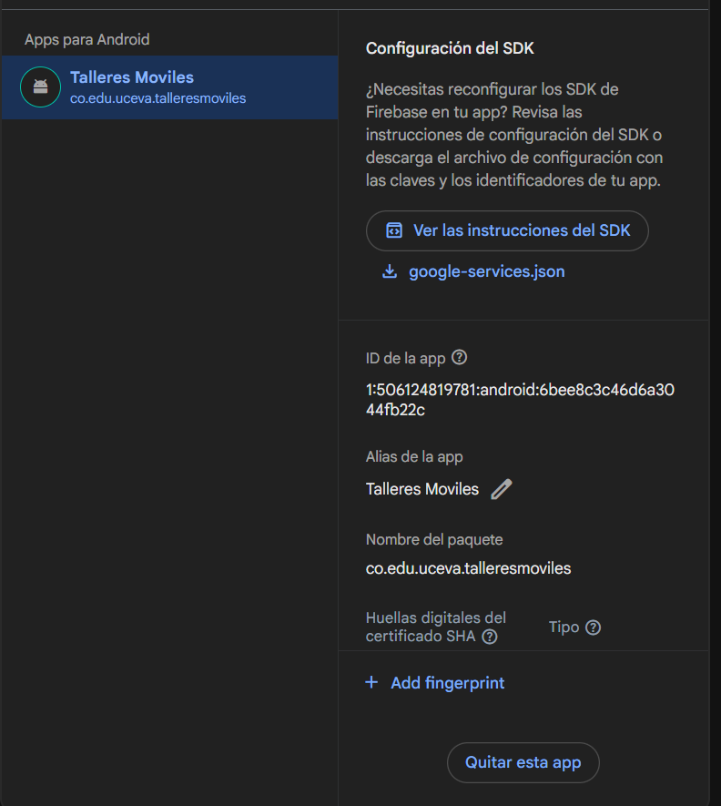<br>App Android registrada</td>
    <td align="center">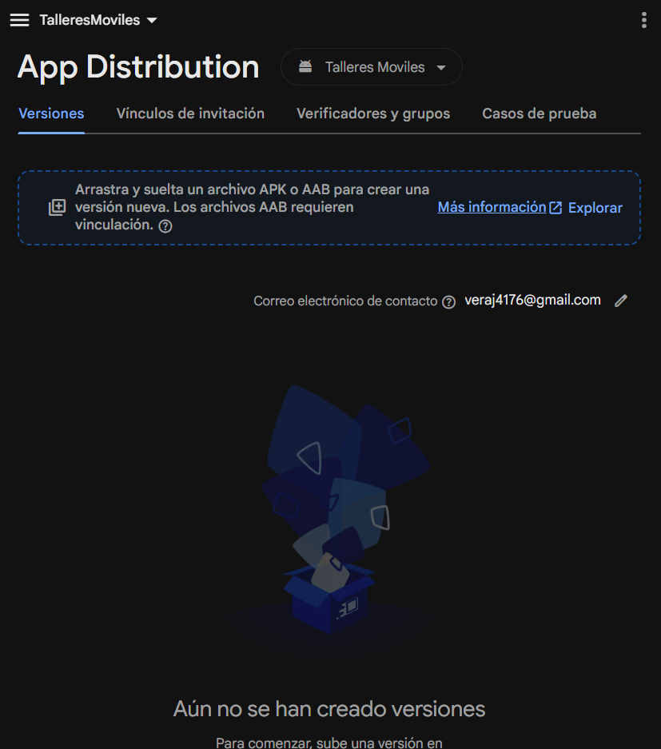<br>App Distribution (antes de subir)</td>
  </tr>
</table>

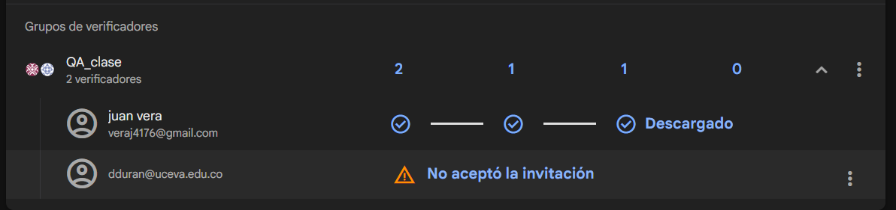<br>Grupo `QA_clase` con los testers

### Correo de invitación y App Tester
<table>
  <tr>
    <td align="center">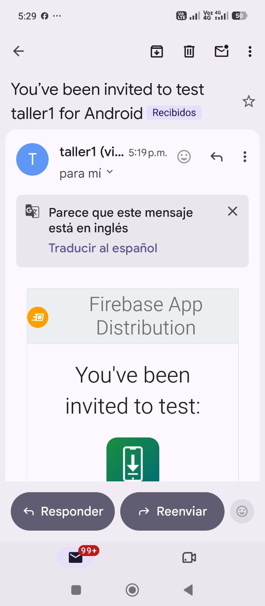<br>Correo de invitación</td>
    <td align="center">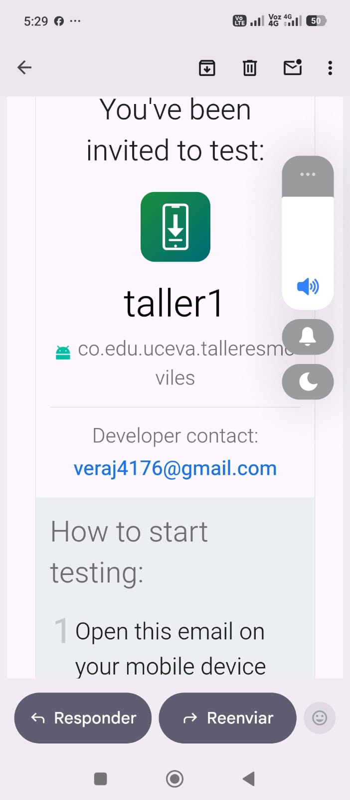<br>Detalle del correo</td>
    <td align="center">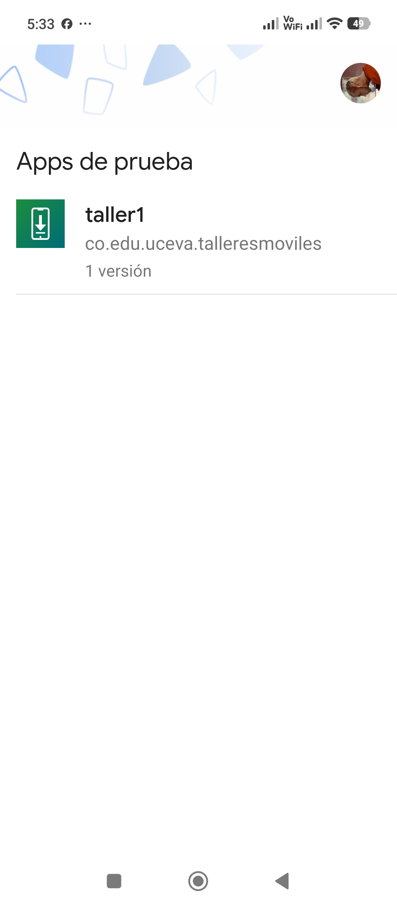<br>Firebase App Tester</td>
    <td align="center">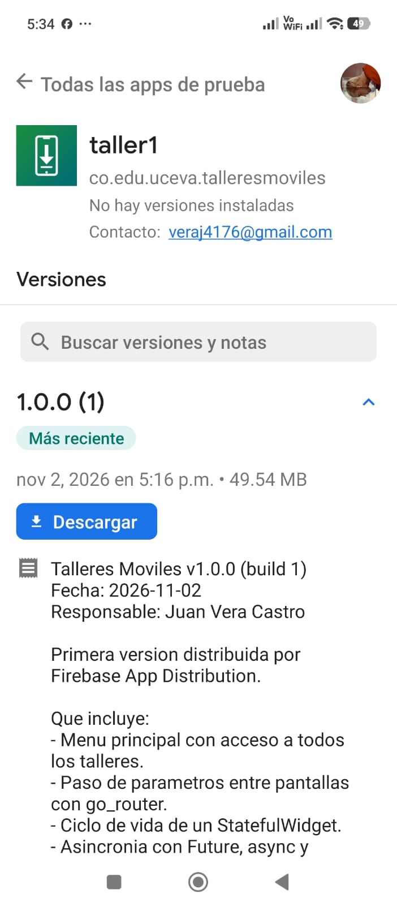<br>Release Notes 1.0.0</td>
  </tr>
</table>

### Actualización 1.0.0 → 1.0.1
<table>
  <tr>
    <td align="center">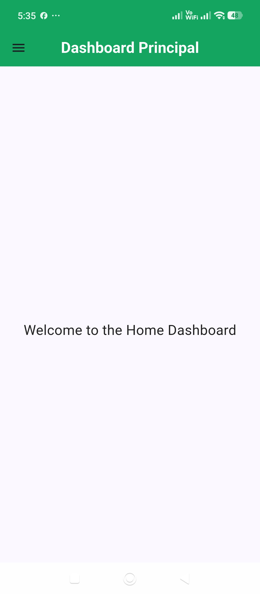<br>Antes: 1.0.0</td>
    <td align="center">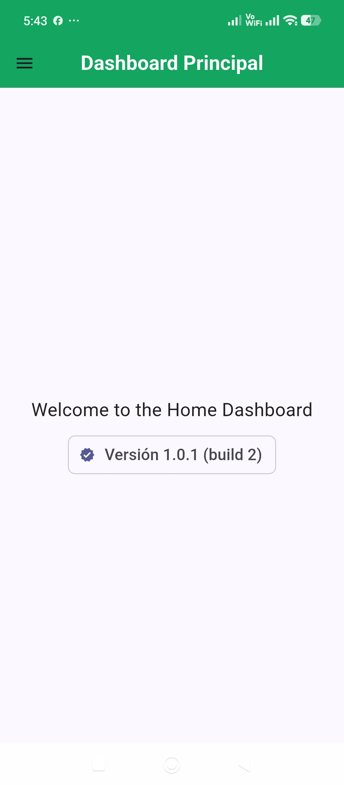<br>Después: 1.0.1</td>
  </tr>
</table>

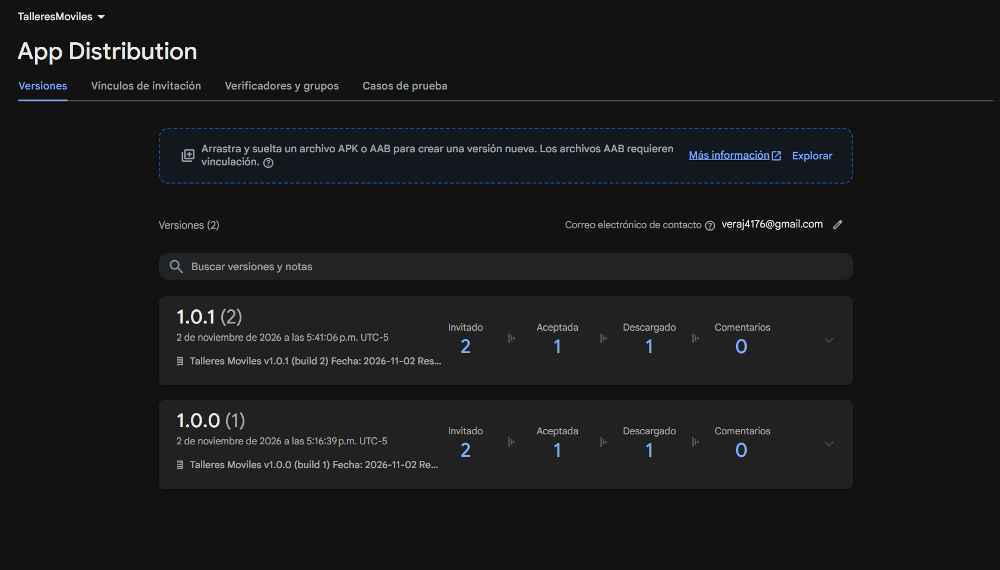<br>Panel de Releases con las versiones 1.0.0 y 1.0.1

---

# Taller: Segundo plano (Future, Timer, Isolate)

Rama: `feature/taller_segundo_plano`

La app usa `go_router`. Todas las pantallas se abren desde el **Drawer** (botón de 3 líneas del AppBar).

## Estructura

```
lib/
├── main.dart                         # MaterialApp.router
├── routes/app_router.dart            # Rutas de la app
├── services/datos_service.dart       # Servicio simulado con Future.delayed
├── isolates/tarea_pesada.dart        # Función CPU-bound y punto de entrada del Isolate
├── views/
│   ├── asincronia/asincronia_screen.dart
│   ├── cronometro/cronometro_screen.dart
│   └── isolate/isolate_screen.dart
└── widgets/                          # BaseView y CustomDrawer
```

## ¿Cuándo usar cada uno?

| Herramienta | Cuándo usarla | Ejemplo en la app |
|---|---|---|
| **Future** | Para un valor que estará disponible **más adelante**: peticiones HTTP, lectura de archivos, base de datos. | `DatosService.consultarDatos()` retorna `Future<List<String>>`. |
| **async / await** | Para **esperar** un Future con código que se lee de arriba hacia abajo, sin bloquear la UI. Los errores se capturan con `try/catch`. | `AsincroniaScreen.consultar()` espera el servicio y cambia el estado. |
| **Timer** | Para ejecutar algo **después de un tiempo** (`Timer`) o **cada cierto intervalo** (`Timer.periodic`): cronómetros, cuentas regresivas, refrescos automáticos. Siempre hay que cancelarlo (`cancel()`) en `dispose`. | El cronómetro suma una décima cada 100 ms. |
| **Isolate** | Para trabajo **pesado de CPU** (cálculos grandes, procesar imágenes, parsear JSON enorme). Corre en otro hilo con su propia memoria, así que la UI no se congela. Se comunica por mensajes (`SendPort` / `ReceivePort`). | Suma de 1 a 1.000.000.000 con `Isolate.spawn`. |

> **Diferencia clave:** `Future`/`async`/`await` **no** crean otro hilo: solo esperan sin bloquear mientras otra cosa (red, disco, un temporizador) hace el trabajo. Si el trabajo es del propio procesador, un `await` no basta y la UI se congela; para eso está el **Isolate**.

## Pantallas

| Pantalla | Ruta | Qué demuestra |
|---|---|---|
| Dashboard Principal | `/` | Pantalla de inicio |
| Future / async / await | `/asincronia` | Estados *Cargando… / Éxito / Error* y orden de ejecución en consola |
| Cronómetro (Timer) | `/cronometro` | Iniciar / Pausar / Reanudar / Reiniciar, cancelación del timer |
| Isolate | `/isolate` | Tarea pesada en un Isolate vs. en el hilo principal |

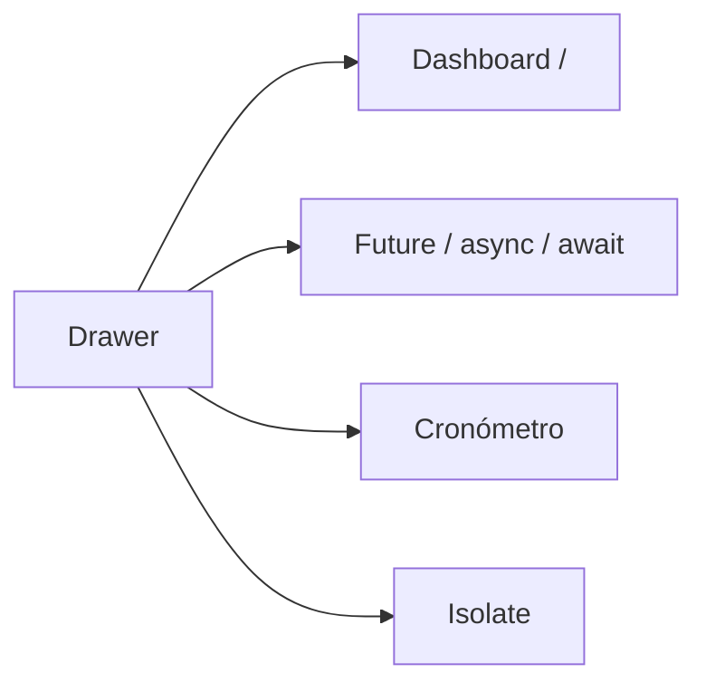

## Flujo 1: Future / async / await

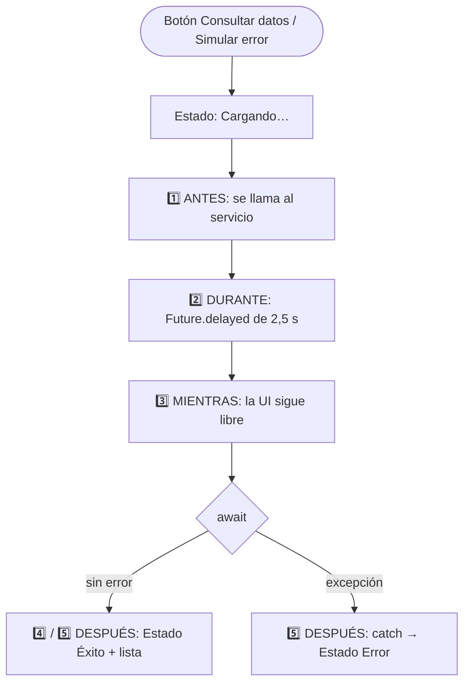

Salida en consola (orden real de ejecución):

```
1️⃣ ANTES -> Se llama al servicio
2️⃣ DURANTE -> El servicio empezó la consulta (esperando...)
3️⃣ MIENTRAS -> La UI sigue libre, el Future está pendiente
4️⃣ DURANTE -> El servicio recibió la respuesta
5️⃣ DESPUÉS -> Datos recibidos: 4 elementos
```

El mensaje 3️⃣ sale **antes** de la respuesta. Eso prueba que la función no se queda bloqueada esperando. Después de cada `await` se revisa `mounted`, para no llamar `setState` si el usuario ya salió de la pantalla.

## Flujo 2: Cronómetro

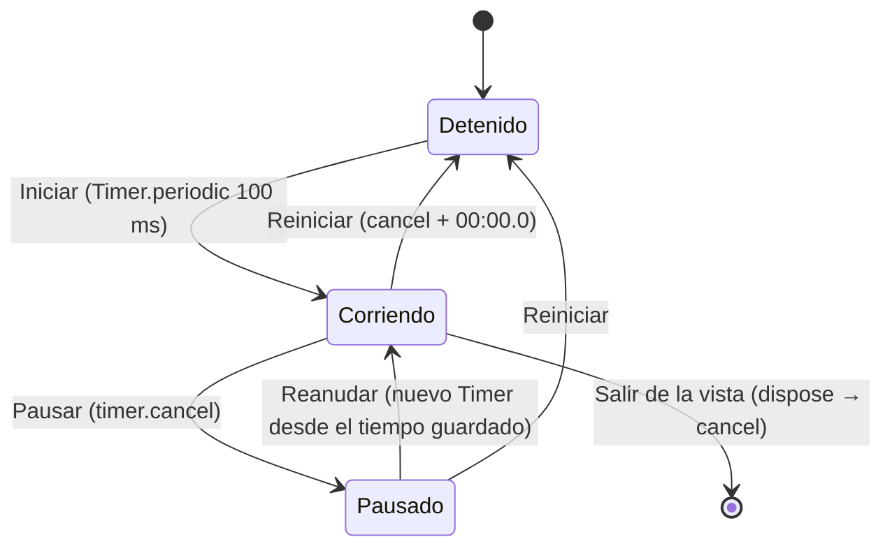

- El tiempo se muestra en un `Text` grande estilo marcador (`mm:ss.d`).
- Cada botón solo se habilita en el estado donde tiene sentido, así nunca hay dos timers corriendo a la vez.
- `dispose()` cancela el timer al salir de la vista (limpieza de recursos).

## Flujo 3: Proceso pesado con Isolate

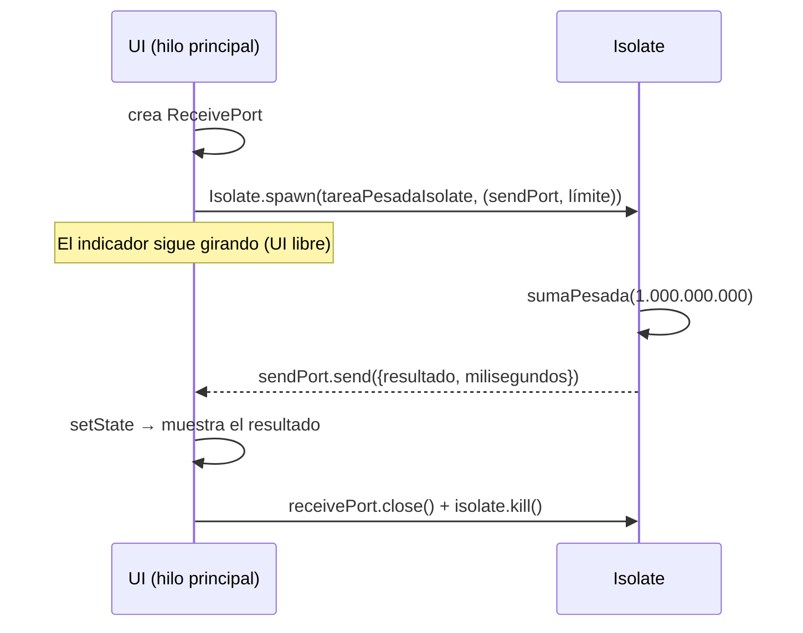

- `tareaPesadaIsolate` es una función **top-level**, como exige `Isolate.spawn`.
- El botón **Ejecutar sin Isolate** hace el mismo cálculo en el hilo principal: el indicador de carga se congela. Así se ve la diferencia.
- Si se sale de la pantalla durante el cálculo, `dispose()` cierra el puerto y termina el Isolate.

## Capturas

Tomadas en el emulador Pixel 8 (Android 16).

### Inicio y menú
<table>
  <tr>
    <td align="center">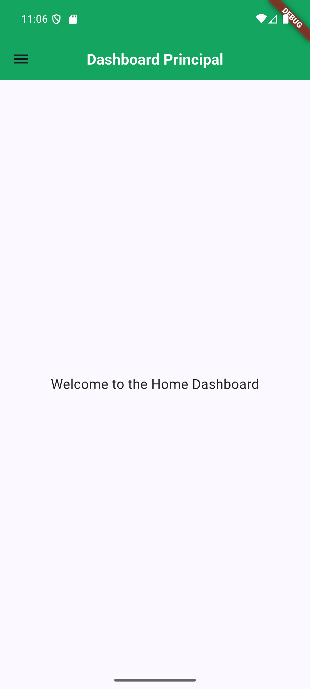<br>Inicio</td>
    <td align="center">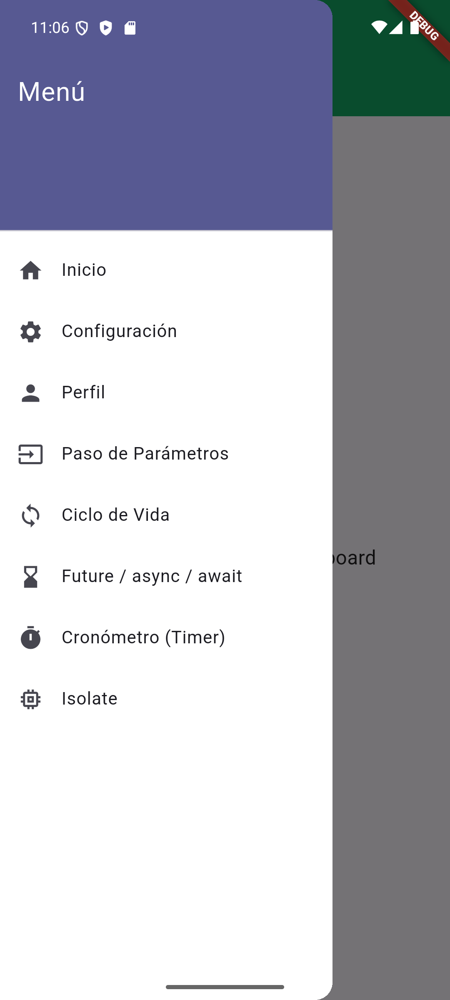<br>Menú (Drawer)</td>
  </tr>
</table>

### Future / async / await
<table>
  <tr>
    <td align="center">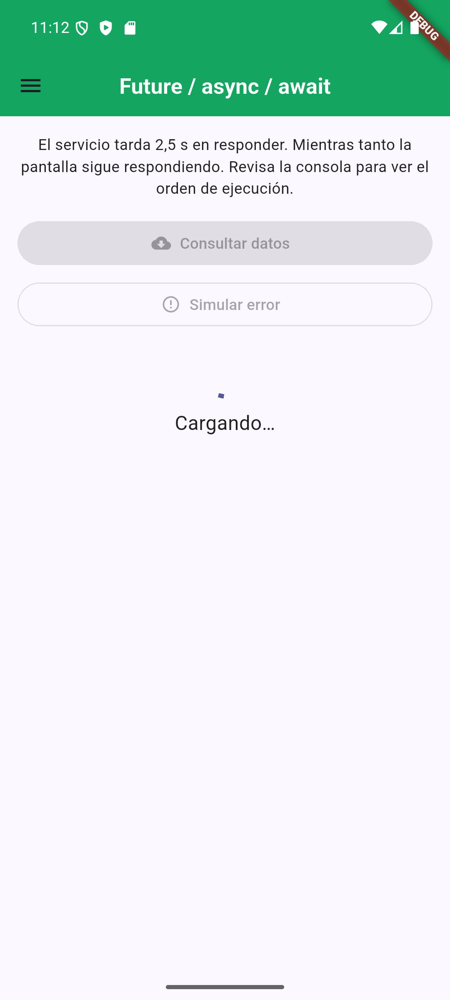<br>Cargando…</td>
    <td align="center">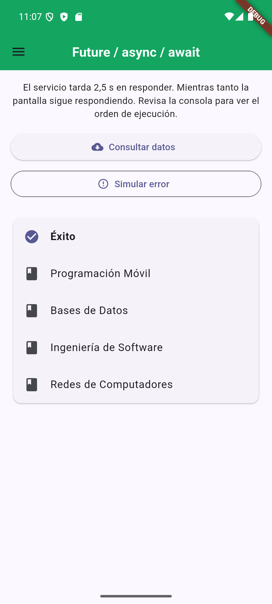<br>Éxito</td>
    <td align="center">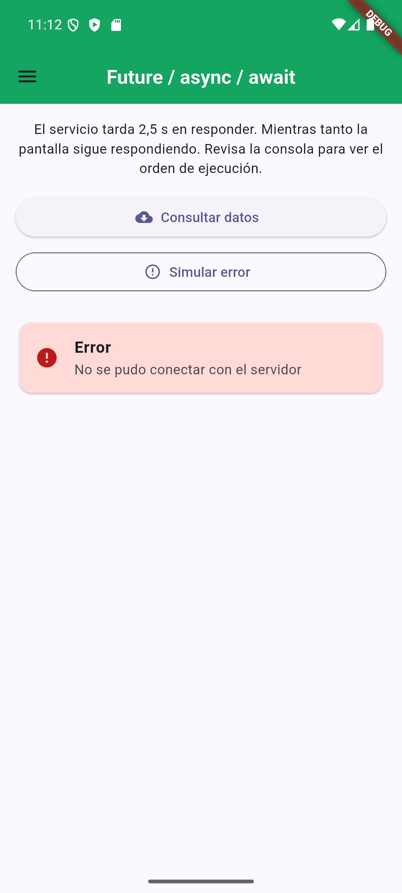<br>Error</td>
  </tr>
</table>

### Cronómetro (Timer)
<table>
  <tr>
    <td align="center">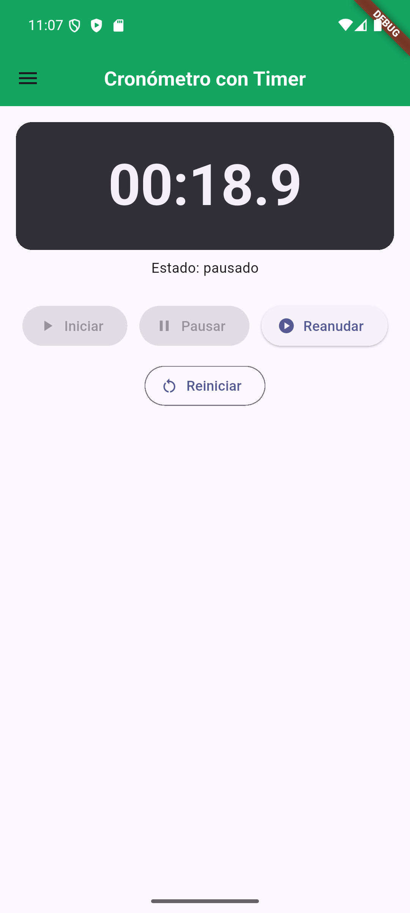<br>En pausa: solo Reanudar y Reiniciar están activos</td>
  </tr>
</table>

### Isolate
<table>
  <tr>
    <td align="center">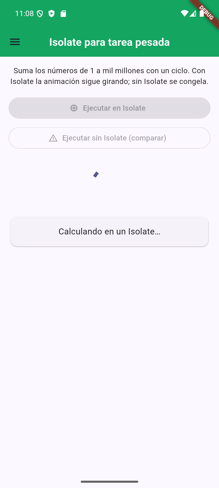<br>Calculando (el indicador sigue girando)</td>
    <td align="center">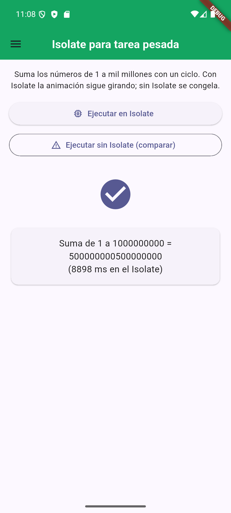<br>Resultado recibido por mensaje</td>
  </tr>
</table>

---

# Taller 1: Widgets básicos

Aplicación que demuestra el uso de widgets básicos de Flutter
(Scaffold, AppBar, Text, Row, Image, ElevatedButton, Container, ListView)
y manejo de estado con setState(). El código está en la rama `feature/taller1`.

## Widgets usados
- Scaffold, AppBar, Text
- Row, Image.network, Image.asset
- ElevatedButton + setState
- Container, ListView (dentro de un Drawer, se abre con el botón de 3 líneas del AppBar)

### Widgets adicionales
- **Stack**: texto sobre una imagen con degradado (sección "Destacado")
- **GridView**: 4 celdas con icono y texto (sección "Accesos rápidos")

### Otros widgets de apoyo
- Drawer, ListTile, SnackBar
- Column, Padding, SizedBox, SingleChildScrollView (diseño)
